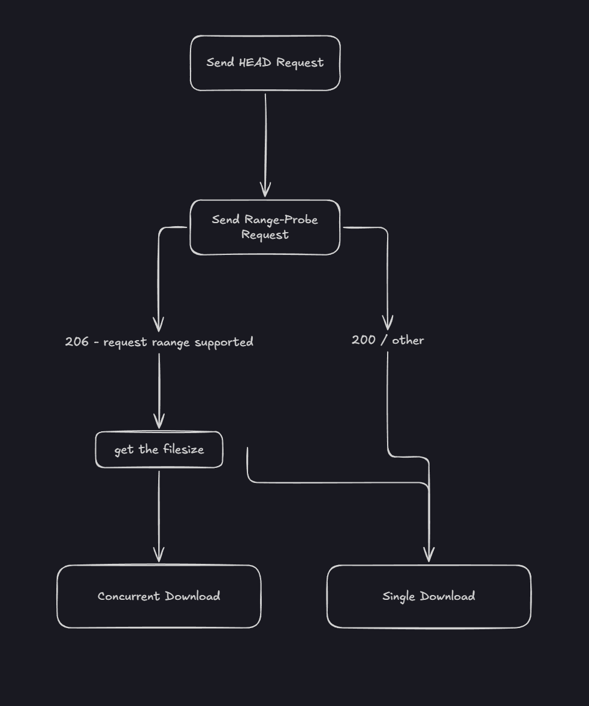

This file contains some of the decisions i made while making this application

### what to do if HEAD request doesn't provide `TotalFileSize`
At `internal/metadata/metadata.go`      
*Why do we need the `TotalFileSize` ?*      
- It is used to calculate the `baseSize` of the chunks required to do the chunk's start and end byte calculation. At `internal/chunks/chunks.go`
*What can be done ?*
- If the **HEAD** request does not provide `Content-Length`, make a probe **GET** request
- If the probe responds with **206 Partial Content**, use the response's `Content-Length` as the file size
- If the probe responds with any status code other than **206 Partial Content**, or its `Content-Length` is unavailable, fall back to a *single download*  

### how should the `FetchMetadata` in `/internal/metadata/metadata.go` tell the caller `/internal/controller/controller.go`, whether to do chunking or do single download
*Approach 1*
- Create custom errors and the `controller.go` does `errors.Is()` for the next control flow
- But it isn't exactly an error
*Approach 2*
- add one more return value to `FetchMetadata` that the `controller.go` can use for control flow
- this one is more clear than just wrapping decisions into errors